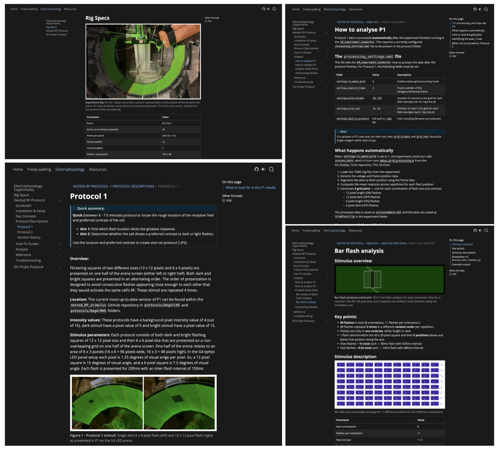

*"Where do you dispose of the aerosol cans?" "How did you preprocess that data?" "I have a new virus, what do I do with it?"*

Every lab has questions like these, and they get asked again and again. Sometimes it's a new colleague asking, and sometimes it's you, six months later, looking at something you did and thinking, "why on earth did I do it that way?" It might be the exact parameters used in an analysis, or simply which buttons to press, and in which order, to turn on a piece of equipment. In most labs, a lot of the important knowledge lives in one or two people's heads. Then they leave, and the rest of the lab is left in the lurch.

Two weeks into my postdoc, I was asked to show visiting students how to run an experiment on a rig I had never used. It was a daunting task, and I was rescued by a lab wiki that had been set up for exactly that system ([G4 documentation](https://reiserlab.github.io/Modular-LED-Display/G4/)). The wiki covered the rig I had to run, and it also had historical documentation on previous generations of the setup. I was so impressed that I decided to build a similar resource for my own work. My colleague Frank, who had created that wiki with Just the Docs, encouraged me to try Quarto instead.

You can see the result at my [live documentation website](https://leburnett.github.io/reiser-documentation/). It has turned out to be useful in more ways than one. It documents my work, it leaves something behind for the people who take it over, and it lets collaborators look at the details of my analysis scripts: the rationale behind a workflow, how I designed a stimulus, how to use a specific tool.

In this post, I'll try to convince you that a resource like this is worth making, and then walk you through building a simple version for yourself with Quarto.

{width=100%}

## Why make a documentation website?

- **Future you will thank you.** Robust documentation saves you from re-learning your own pipeline six months later.
- **It makes your work reproducible.** Methods, parameters and decisions written down in one place are far easier to check and repeat than ones that live in your head or a lab notebook.
- **It makes handover easy.** When a student or postdoc leaves, or a new person joins, the documentation is the onboarding.
- **It makes your code and data reusable.** Funders and journals increasingly expect open, reusable resources, and a README alone rarely explains enough.
- **It is visible.** A website can be linked from a paper, CV or poster, and it can be found and cited.
- **It is cheap.** Static, public sites are free to host on GitHub Pages and need no server to maintain.

## Why Quarto?

What I liked most about Quarto was how easy it was to use and how quickly I could set it up. A site is just a folder of text files plus one settings file, so there is no theme or build system to learn. Because the pages are plain text, they can also be version controlled through the exact same pipeline as your code.

One feature I find especially useful is exporting pages as PDFs. Quarto offers other formats too, but I found PDF the easiest to limit myself to. My thinking was that new group members or visitors could go to a page with a specific protocol or information about a rig, and print it out if they wanted a copy.

- **Plain-text writing.** Pages are Markdown files (`.qmd`, explained in [What are `.qmd` files?](#what-are-qmd-files) below), so they sit in version control next to your code.
- **Your code can run inside the pages.** Python, R, Julia and Observable are supported, so figures and tables are generated when the site is built and never go out of date.
- **One source, many outputs.** The same files can produce a website, a PDF, a Word document or slides.
- **Researcher-friendly features.** Citations and bibliographies, cross-referenced figures, equations, callouts and tabs are built in.
- **Little setup.** A folder of text files plus one `_quarto.yml`.
- **Free and open source,** and maintained by Posit.

### Other options

Quarto is not the only choice. It is a good fit when your documentation mixes prose with analysis code, in more than one language if need be, or when you also want slides, papers or a personal site from the same tool. Sphinx is the stronger choice for documenting the API of a Python library. Here is how the main alternatives compare:

| Tool | Best for | Notes |
|---|---|---|
| [**Quarto**](https://quarto.org/) | Documentation that mixes prose with analysis code | Runs Python, R, Julia and Observable inside pages; exports to websites, PDFs, Word and slides; built-in citations and cross-references. |
| [**Sphinx**](https://www.sphinx-doc.org/en/master/) | Python packages | Strong API documentation generated from docstrings; steeper learning curve. |
| [**Just the Docs**](https://just-the-docs.com/) | Simple, clean docs sites | A Jekyll theme that GitHub Pages builds for you; no code execution. |
| [**MkDocs**](https://www.mkdocs.org/) (and [Material for MkDocs](https://squidfunk.github.io/mkdocs-material/)) | Markdown docs with minimal config | Polished, popular and easy to start with. |
| [**Jupyter Book**](https://jupyterbook.org/) | Notebook-heavy documentation | Built around Jupyter notebooks and MyST Markdown. |
| [**pkgdown**](https://pkgdown.r-lib.org/) | R packages | Builds a site directly from an R package. |
| [**Read the Docs**](https://about.readthedocs.com/) | Hosting (usually Sphinx or MkDocs) | Free hosting with versioned docs. |

## Step-by-step instructions

The bare minimum for a working site is surprisingly small: one settings file (`_quarto.yml`) and one page (`index.qmd`). Quarto creates both for you, so you only need to install it and run one command. Steps 1 to 5 get you a site running on your own computer. Steps 6 to 8 put it online. After that, I cover some optional extras.

### Build and preview the site

1. **Install Quarto** from [quarto.org](https://quarto.org/docs/get-started/).

2. **Create a project.** In a terminal, go to the folder where you want your project to live and run:

    ```bash
    quarto create project website my-docs
    ```

    This creates a new Quarto website in a new folder called `my-docs`. Here is what each part of the command means:

    - `project` is the type of thing being created.
    - `website` is the project template (others include `default`, `blog`, `book` and `confluence`).
    - `my-docs` is the folder name, which also becomes the site's default title. Name it whatever you like.

    By default, the folder is filled with these files:

    - `_quarto.yml`: the project settings (site title, navigation bar, theme, output options).
    - `index.qmd`: the home page.
    - `about.qmd`: a sample About page.
    - `styles.css`: an empty stylesheet for custom CSS.

    Quarto's own [Creating a Website guide](https://quarto.org/docs/websites/) walks through this step with screenshots for VS Code, RStudio and Positron, so you can follow along in whichever editor you use.

3. **Write your pages** as `.qmd` files. Start with the placeholder `index.qmd` and describe what the project is and what it does. I use VS Code to edit my `.qmd` files, but any text editor works because they are plain text (see [What are `.qmd` files?](#what-are-qmd-files) below).

4. **Set up navigation** in `_quarto.yml`, using a navigation bar (`navbar`) or a `sidebar` to list your pages. See [Organising your site with the navbar](#organising-your-site-with-the-navbar) below for a worked example.

5. **Preview as you work.** From inside your project folder, run `quarto preview` in the terminal. The site rebuilds and refreshes in your browser each time you save.

### Put it online with GitHub

The following steps happen on GitHub.

6. **Put the project on GitHub:** run `git init`, commit your files, create a repository and push.

7. **Publish to GitHub Pages**, using one of two routes:
    - *Quick:* run `quarto publish gh-pages` from your project. It builds the site and pushes it to a `gh-pages` branch.
    - *Automatic:* add a GitHub Actions workflow (Quarto provides one) that rebuilds and deploys the site on every push.

8. **Turn on Pages** in the repository under *Settings → Pages*, and choose the branch or "GitHub Actions" as the source.

You can now **share the link** (`https://<username>.github.io/<repo>/`)!

The `<repo>` part is the name of your GitHub repository, which you choose when you create it in step 6. It does not have to match the `my-docs` folder name from step 2, but using the same name keeps things simple. For example, if your GitHub username is `jsmith` and your repository is called `my-docs`, your site will be at:

```
https://jsmith.github.io/my-docs/
```

### Optional extras

None of these are needed for a working site, but they are all nice to have.

- **Code.** Quarto can run code in embedded cells and put the output on the page. If you plan to do this, make sure Python or R is installed.
- **Figures.** I recommend an `assets` folder that mirrors the structure of your pages, with each page's images in the matching place.
- **Citations.** Add a `references.bib` file, a plain-text BibTeX bibliography that most reference managers can export. It is easy to keep in version control. Quarto formats citations in whatever style you choose and builds the reference list at the end of the page for you.

## Organising your site with the navbar

A Quarto site uses two kinds of YAML, and it helps to know which is which:

- **`_quarto.yml`** is the settings file for the *whole site*. It decides which pages appear in the navigation bar, and in what order.
- **The YAML front matter** at the top of each page holds the settings for *that page only* (see [What is YAML front matter?](#what-is-yaml-front-matter) below).

They connect in one place: the navbar lists pages by file name, and by default each link is labelled with that page's `title` from its front matter. So the front matter decides what a page is called, and `_quarto.yml` decides where it appears.

### Example: a small lab documentation site

Say your project folder looks like this:

```
my-docs/
├── _quarto.yml
├── index.qmd
├── about.qmd
└── protocols/
    ├── virus-handling.qmd
    └── rig-startup.qmd
```

Each page starts with its own front matter. For example, `protocols/rig-startup.qmd`:

````markdown
---
title: "Starting up the rig"
description: "The order in which to turn on the components."
---

## Before you begin

Check that the arena is clear...
````

and `protocols/virus-handling.qmd`:

````markdown
---
title: "Handling a new virus"
---

## Storage

Label the tube and put it in the freezer...
````

### The minimum navbar

In `_quarto.yml`, a working navbar only needs the page files listed under `navbar`:

```yaml
project:
  type: website

website:
  title: "My Lab Docs"
  navbar:
    left:
      - index.qmd
      - about.qmd
```

The navbar will show "My Lab Docs" as the site name, then links to your home and About pages. Each link is labelled with the page's front matter `title`. You can also add `right:` for items on the right-hand side (a common place for links like GitHub).

To give a link a different label than the page title, add `text`:

```yaml
      - href: index.qmd
        text: Home
```

### Extras: dropdown menus

As your site grows, group related pages into a dropdown. Note that the page paths include the folder name:

```yaml
website:
  title: "My Lab Docs"
  navbar:
    left:
      - href: index.qmd
        text: Home
      - text: "Protocols"
        menu:
          - protocols/rig-startup.qmd
          - protocols/virus-handling.qmd
      - about.qmd
```

"Protocols" now opens a dropdown with the titles of those two pages. The order in the file is the order on screen.

### Extras: a sidebar instead

For sites with many pages, a sidebar is often easier to navigate than a navbar:

```yaml
website:
  title: "My Lab Docs"
  sidebar:
    style: docked
    contents:
      - index.qmd
      - section: "Protocols"
        contents:
          - protocols/rig-startup.qmd
          - protocols/virus-handling.qmd
      - about.qmd
```

### Things to remember

- **A page that isn't listed is still built.** It exists on the site and can be reached by a direct link, but it won't appear in the navigation.
- **File paths are relative to the project folder,** not to where you happen to be in the terminal. `protocols/rig-startup.qmd` means "the `protocols` folder inside my project".
- **Indentation matters** in `_quarto.yml` just as it does in front matter. If your navbar disappears, check the spacing first.
- **Run `quarto preview`** while you edit. The navbar should update when you save `_quarto.yml`. If it doesn't, stop the preview with Ctrl+C and run it again.

## Tips and detailed explanations

In the AI world we find ourselves in now, creating a site like this is easier than ever. However, sifting through a 3000 word text explaining how to turn on a switch is not useful. Some important things to keep in mind are:

- **Be specific about the goals of the documentation.** Know who it is for and what they need to be able to do.
- **Keep it from becoming long and burdensome.** A TL;DR summary dropdown at the start of each page, clear headings and good navigation all help.
- **Make a template `.qmd` page** if you have several similar protocols, so each one has the same structure.
- **Remember the site is public.** Don't add confidential information. There is a time and a place for electronic lab notebooks, but this is for open-source software and public methods. If you need privacy or security, you can deploy the site on your institution's internal server instead.

I think this sort of site is especially useful for labs that write new software for each setup. These labs are most at risk of losing knowledge when someone leaves, so it matters that the person who builds the setup takes the time to document their thinking for future users.

### What are `.qmd` files?

A `.qmd` file is a plain-text file, like a normal Markdown file, with some extra features. You can open and edit it in any text editor. A plain text editor won't show you the finished page, though. For that you need Quarto (`quarto preview`).

If you already know Markdown, then headings, lists, links, images, bold and italics all work as usual. Here is what Quarto adds:

- **YAML front matter** at the top of the file, which holds the page's settings (explained in the next section).
- **Executable code chunks.** The code runs and its output is placed in the final page.
- **Cross-references.** Use the `@` symbol to link to figures and tables, for example `@fig-plot`.
- **Citations.** Write `[@Smith2020]` to cite directly from your `.bib` file.
- **Callouts, tabsets and layout.** These use "fenced divs", which are blocks wrapped in `:::` lines. They give you note boxes, tabs, columns and more.
- **Maths.** LaTeX syntax works for equations.
- **Many output formats.** The same file can be exported to HTML, PDF, Word, slides and more.

For example, a note box looks like this in your `.qmd` file:

````markdown
::: {.callout-note}
This text appears in a highlighted note box.
:::
````

Other callout types are `.callout-tip`, `.callout-warning`, `.callout-important` and `.callout-caution`.

### What is YAML front matter?

The YAML front matter is a short block of settings at the very top of a `.qmd` file, between two lines of three dashes (`---`). It can look intimidating, but it is only a list of `setting: value` pairs.

#### The minimum

For a working page you only need a `title`:

````markdown
---
title: "My Page"
---
````

A `description` is also worth adding, since it is used in site listings, search results and link previews:

````markdown
---
title: "My Page"
description: "A one-sentence summary of the page."
---
````

`title` is shown as the page heading and in the browser tab. If you set it, don't also add a `# Heading` with the same text at the top of the page, or the title will appear twice.

#### Useful extras

A fuller example:

````markdown
---
title: "Page Title"
subtitle: "Optional subtitle"
author: "Your Name"
date: 2026-10-15
description: "One-sentence summary"
categories: [quarto, tutorial]
---
````

- `subtitle`: a second line shown under the title.
- `author` and `date`: shown under the title. `date: last-modified` fills in the date automatically.
- `categories`: tags for blog or listing pages, e.g. `[quarto, tutorial]`.
- `image`: a thumbnail shown in listings and link previews, e.g. `image: thumbnail.png`.
- `draft: true`: hides the page from listings and the site, which is useful for unfinished posts.
- `bibliography`: your citations file, e.g. `bibliography: references.bib`, if it is not set for the whole project.
- `toc: true`: adds a table of contents (it can sit under `format: html:`).
- `execute`: controls how code chunks behave, e.g. `echo: false` hides the code and shows only the output.
- `page-layout: full` or `title-block-banner: true`: layout and appearance tweaks.
- `format`: the output type (`html`, `pdf`, `docx`, `revealjs`). In a website project this is usually set once in `_quarto.yml` and inherited by every page, so you rarely need it in a page.

#### Three things that catch people out

- **Indentation matters.** Settings nested under another setting need consistent spacing:

    ```yaml
    format:
      html:
        toc: true
    ```

- **Quote text containing colons or special characters,** for example `title: "Part 1: Setup"`.
- **Settings in `_quarto.yml` apply to the whole site,** and a page's front matter overrides them. This means each page's front matter can stay short.

## Troubleshooting

Here are the problems people most often hit when starting out.

- **`quarto: command not found`.** The terminal can't find Quarto, usually because it was already open when you installed it. Close and reopen the terminal (in VS Code, restart VS Code). Running `quarto check` confirms the install.
- **Running a command from the wrong folder.** `quarto preview` and `quarto publish` must be run from inside your project folder. Run from one level up, they give confusing errors or preview only a single file. Use `cd my-docs` first.
- **`quarto create` made the folder in the wrong place.** The new folder appears wherever the terminal currently is, for example inside another project.
- **YAML errors.** These usually come from bad indentation, a tab character, a missing space after a colon (`title:"x"`), or an unquoted colon in a title. The error message normally names the file and line.
- **Code chunks failing.** Python or R isn't installed, or a package your code imports is missing. `quarto check` shows what Quarto can find. If a page has no code chunks, you need neither.
- **Edits not showing in the preview.** Check the terminal for an error message, since the preview may have stopped. Make sure your browser is on the current preview tab. A page that isn't listed in the navbar or sidebar can be hard to find.
- **Broken images or links.** Paths are relative to the page's location. They are also case-sensitive on GitHub Pages, even if they work on your own computer.
- **A published site that is blank or shows a 404.** Wait a minute or two after publishing. If it persists, check that *Settings → Pages* points at the right source or branch.
- **A `_site` folder appearing in your project.** Quarto writes the built website there by default. This is normal.
