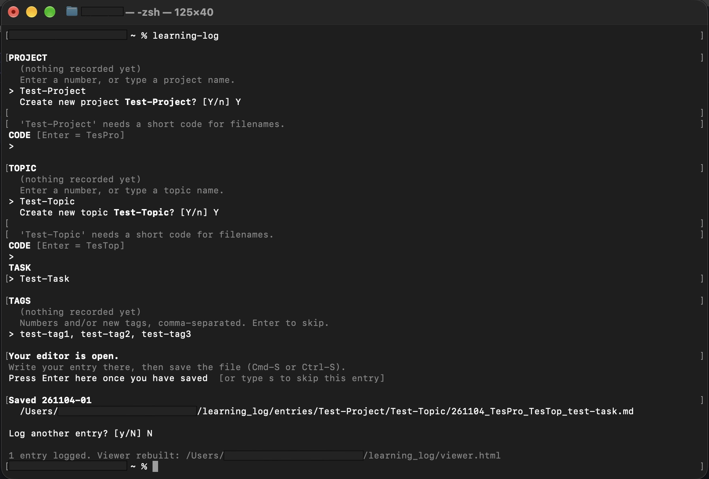
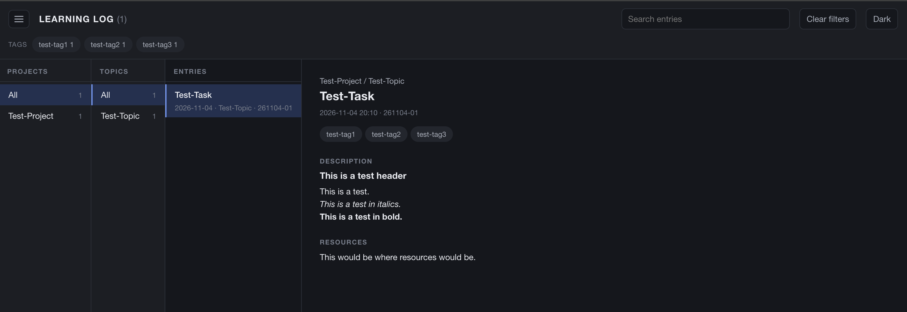
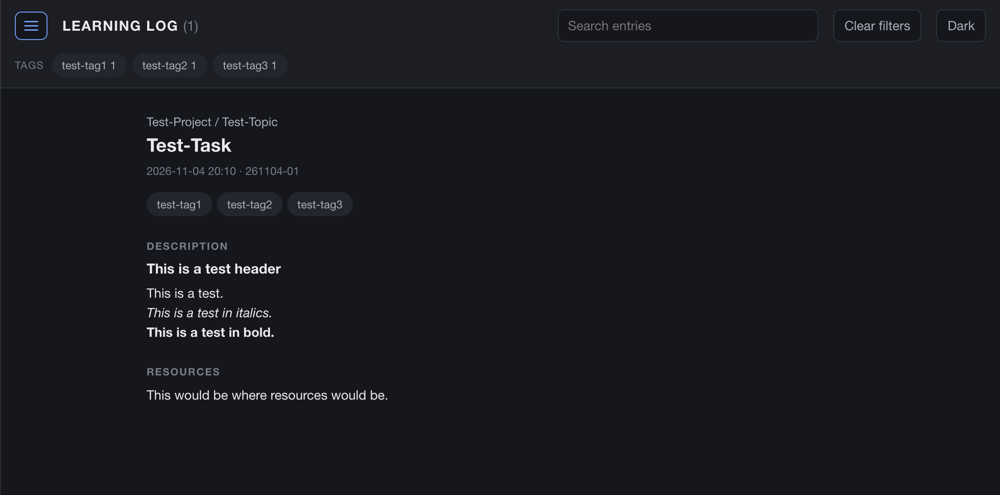
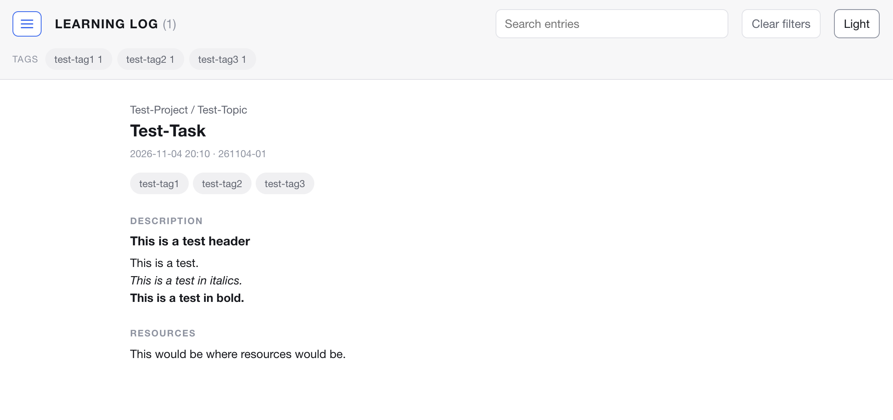

Keeping track of what I've learnt and accomplished has been an ongoing challenge for me for some time.

I'm doing a lot of self-directed learning at the moment and have once again found myself looking for a simple method to log my progress. 

When I was doing more hands-on experiments at the bench this was a lot easier to keep track of in my physical lab notebook, but I've always found it more difficult to record analyses and the things I've been learning about digitally, in a way that is cohesive and that I can actually find again later.

I've tried a few different methods: a digital lab notebook, OneNote, Apple Notes. They all had their pros and cons, but ultimately none of them lasted or adapted to different forms of learning. I think a big problem is finding the time to think about what it is that I've actually accomplished that day or week and consolidate that into concise prose. 

Being a pretty visual learner (read hand-drawn mind maps and diagrams), I feel that no digital method will truly be the best way for me to collect everything I have learnt in one place, but I still wanted a way to create a relatively lightweight digital record of the tasks and topics I've covered. To be honest, I think this is an area where AI-based tools like Granola, or other voice-to-text methods will really come into their own, but for now I'm sticking to a vanilla typing method.

So, as a small *Claude Code* project that I completed in about 2 hours one evening, I created [**learning_log**](https://github.com/leburnett/learning_log), a **Python command-line tool** for logging what you've been learning. My main aim was to create something that I'll hopefully be able to incorporate into my daily practice.

## What I wanted from it

When building this tool I was thinking about two things:

1. How do I want to use it?
2. What do I want the output to be?

**How I wanted to use it.**

My main goal was to make something that will be **very easy** for me to use. 

When imagining how I might want to use this tool, I decided I wanted something I could launch straight from the **terminal** and from whatever folder I happen to be in. Ultimately, the idea would be to incorporate this into an automatic workflow that prompts me to create an entry at the end of every day.

**Some design choices:**

- **It asks me the questions.** The project, topic and task are prompts rather than things I have to remember to type, and the date and time are filled in automatically.
- **It remembers what I've used before.** Each prompt offers the projects, topics and tags I've already used, so I pick a number instead of retyping `Image Analysis` and getting it slightly wrong.
- **One topic per entry.** If I learnt three things today, that's three entries rather than one long one. A single-subject entry seemed a cleaner approach, where individual entries can be filed, tagged and found again.

**What I wanted the output to be.**

Practically, I wanted the output of the tool to be **Markdown files**. I did consider a more structured format like JSON, but ultimately decided on Markdown for its simplicity, its formatting options and the fact that it is human-readable. I also thought that these Markdown files would be easy for an LLM to read in the future if I wanted to modify or add to the tool.

However, I knew that I wanted a separate **viewer** that was more aesthetically pleasing to actually browse and review the content of these files in. I've built a lot of web-based resources recently and like the versatility that is possible in HTML formats, so I made the **viewer.html** file.

::: {.callout-note}
## Why I like creating HTML outputs

- **Nothing to install.** You don't need a library to write one, or any particular software to open it, and there's no maintenance either.
- **It's just a file**, so it's fairly easy to share with others.
- **It's incredibly versatile** with lots of opportunities to add interactive elements.
- **You can control how it looks** with CSS.
- **You're not limited to a fixed page size**, as you are with something like a PDF.
:::

## What it is

Pure Python standard library, 3.8 or newer — no virtual environment and no dependencies to install.

Entries are plain Markdown files with front matter. The first few fields are filled in through prompts in the terminal, which offer back anything you have used before, and the rest you write in a text editor:

| Where you fill it in | Fields |
|---|---|
| Terminal prompts | Project, Topic, Task, Tags |
| Text editor | Description, Resources |

## Should you use it?

I made this tool to be suitable for anyone who's comfortable writing in Markdown and wants a simple, dependency-free method to keep track of their learning. My aim eventually is to incorporate this into my daily workflow, when I'm reviewing what I've done for the day and thinking about tasks to be done. Obviously, it will not suit you if you want tables, images, a phone app, or anything collaborative.

## Writing an entry

Type `learning-log` into a new terminal.

A prompt will ask you for the project, topic, task, tags, and optionally any earlier entries to link to.

Each prompt is a numbered menu of what you have used before: pick a number, or type something new and it is remembered for next time. For anything new it proposes a short code for the filename — `Freely Walking Optomotor` becomes `FWO` — which you accept with Enter.

If you have already filled in an entry, it will prompt you whether you want to use one of the existing projects or topics.



Your editor then opens a template with all of those fields already filled in, so you only need to write the Description and Resources.

Doing the short answers in the terminal and the long ones in an editor seems overly complicated at first, but the split is deliberate. A plain text file can't offer you a menu, so the only way to keep project and topic names consistent is to ask before the editor opens. And a terminal prompt is a miserable place to write a formatted paragraph — text editors are much easier for writing Markdown, especially if the description runs long.

You save the file, go back to the terminal, press Enter, and it asks whether you want to log another. If you press Enter before saving, it tells you nothing has arrived yet and asks again, so nothing is lost. Entries open in whatever your computer already uses for plain text files, so there's nothing to configure before the first run.

## Where entries go

Once saved, entries are stored in the folder:

```
entries/<Project>/<Topic>/YYMMDD_Proj_Topic_task-name.md
```

for example:

```
entries/ImageAnalysis/Segmentation/261104_ImgAna_Segmen_comparing-watershed-and-cellpose.md
```

Folders use the full readable names, and only the filename uses the short codes, which keeps filenames short enough to read while still saying what's in them. Each file looks like this:

```markdown
---
id: 261104-01
date: 2026-11-04
time: 16:42
project: ImageAnalysis
topic: Segmentation
task: Comparing watershed and Cellpose
tags: [segmentation, benchmarking]
related: [261031-02]
---

## Description

Cellpose handled touching objects far better, but was ~20x slower.

## Resources

- https://example.org/some-paper
```

Everything above the second `---` is filled in for you.

## Linking entries

Every entry gets a short id — `261104-01`, the date plus a counter for that day. You can pick entries to link to from a menu before the editor opens, or write `[[261104-01]]` inline anywhere in your prose.

You only ever have to link in one direction. If entry A points at entry B, the viewer works out for itself that B should show a "Referenced by" link back to A. I didn't want a system where keeping the links accurate was a job in itself, because that's exactly the sort of upkeep that makes me stop using something.

IDs are also never reused, so deleting an entry can't quietly redirect an existing link to a different one. Instead, `learning-log rebuild` tells you about any link that now points at something that isn't there.

## Tags

Tags are lowercase and hyphen-separated, and anything else is rejected rather than quietly cleaned up, with the corrected version offered for you to accept:

```
  x 'Spike Sorting!' isn't a valid tag (it contains capitals).
    Tags are lowercase, hyphen-separated: a-z, 0-9 and - only.
    Use spike-sorting instead? [Y/n/edit]
```

This was implemented to reduce the possibility of redundant tags being generated, e.g. `Stats`, `stats`, `statistics`. Being slightly strict at the prompt costs one keystroke; fixing a drifted tag vocabulary across a few hundred entries a year later is an afternoon.

## The viewer

`learning-log view` builds `viewer.html` and opens it.

It's a single self-contained file — the styling and everything it needs is inside it — so it works offline and you can double-click it from Finder. It's also rebuilt automatically every time you save an entry. If you have deleted an entry you can rebuild the viewer using `learning-log rebuild`.



The three columns narrow each other down: pick a project, and only its topics show; pick a topic, and only its entries. Dividers drag to resize and remember their widths, and double-clicking one resets it.

Clicking the hamburger icon hides all three columns and makes the entry full-screen, which is what I want when I'm actually reading something rather than looking for it:



There is a tag filter and a search box in the navbar, and a theme toggle in the top right cycling Auto → Light → Dark:



Descriptions render as Markdown — headings, lists, bold, italics, code, quotes and links all work.

`viewer.html` itself is generated and gitignored, but the template it is built from is committed — so the interface is version-controlled and editable like any other source file.

## Keeping the menus tidy

The helper file that remembers your projects, topics and tags only ever grows. I'm often "tidying up" my notes and thought it would be better if the helper file only showed the options that currently exist. You can use:

```bash
learning-log rebuild --prune
```

to rewrite the helper file from what is actually on disk. Since this is quite a destructive action, I set it so that you have to specify `--prune` — otherwise `rebuild` will simply rebuild the viewer file. `rebuild` is a command you run casually, and I didn't want a casual command to be capable of throwing away everything the tool had learnt.

## Privacy

The repository is public but the entries are not. `entries/`, the helper file, the config file and the generated `viewer.html` are all gitignored. Cloning the repository gets you a working tool and an empty log.

The flip side, stated plainly in the README: **this repository does not back up your entries.** If you want them versioned, keep them in a separate private repo, or point `entries_dir` at a folder you already back up.

## Further reading

- [learning_log on GitHub](https://github.com/leburnett/learning_log) — the repository and full README.
